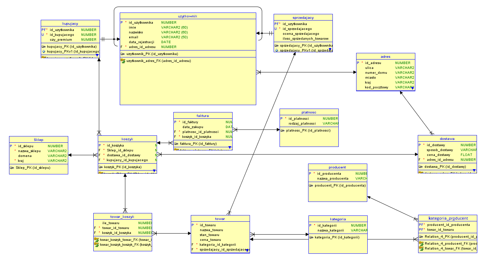

# Online Shop / Sklep internetowy

## EN

### Overview

Online Shop is a database project written in Oracle SQL, developed as a second-year university project at Kielce University of Technology.
The project presents a simplified database model of an online shopping platform inspired by services such as Allegro, eBay, and Amazon. Its purpose is to represent the main elements of an e-commerce system, including users, products, categories, sellers, buyers, shopping carts, deliveries, payments, invoices, and addresses.
The database structure is based on entities and relationships that describe how the individual elements of an online shop are connected. It includes one-to-many and many-to-many relationships, as well as inheritance between users, sellers, and buyers.

### Features

- Create tables representing the main elements of an online shop.
- Define primary keys and foreign key relationships.
- Implement one-to-many and many-to-many relationships.
- Represent inheritance between users, sellers, and buyers.
- Create sequences for automatic ID generation.
- Insert sample data into database tables.
- Test integrity constraints, including `PRIMARY KEY`, `NOT NULL`, `CHECK`, and `UNIQUE`.
- Modify existing tables using `ALTER TABLE`.
- Add and remove columns and constraints.
- Delete records from tables.
- Drop tables and sequences.
- Create database views using `CREATE VIEW`.
- Retrieve data using `SELECT` statements and multiple table joins.
- Filter results using conditions, subqueries, and parameterized values.
- Group and aggregate data using functions such as `COUNT`, `SUM`, `AVG`, `MIN`, and `MAX`.
- Sort query results using `ORDER BY`.
- Use SQL functions such as `LENGTH`, `SOUNDEX`, `TO_DATE`, and `TO_CHAR`.
- Use `CASE` expressions to display different account types.

### Diagram

### Database Entities

1. Shop
2. Category
3. Manufacturer
4. Delivery
5. User
6. Product
7. Seller
8. Buyer
9. Address
10. Shopping Cart
11. Invoice
12. Payment
13. Cart_Product (junction entity)
14. Category_Manufacturer (junction entity)

### Relationships

**One-to-many relationships:**

- Address → User – one address can be assigned to multiple users.
- Address → Delivery – one address can be associated with multiple deliveries.
- Shop → Shopping Cart – one shop can contain multiple shopping carts.
- Delivery → Shopping Cart – one delivery method can be associated with multiple shopping carts.
- Buyer → Shopping Cart – one buyer can have multiple shopping carts.
- Shopping Cart → Invoice – one shopping cart can be associated with multiple invoices.
- Payment → Invoice – one payment can be associated with multiple invoices.
- Category → Product – one category can contain multiple products.
- Seller → Product – one seller can offer multiple products.

**Many-to-many relationships:**

- Shopping Cart ↔ Product (through the Cart_Product entity).
  - One shopping cart can contain multiple products.
  - One product can be included in multiple shopping carts.
- Category ↔ Manufacturer ↔ Product (through the Category_Manufacturer entity).
  - Multiple categories and manufacturers can be associated with multiple products.

**Inheritance relationships:**

- User → Seller – Seller inherits from User.
- User → Buyer – Buyer inherits from User.

### Project Files

All SQL scripts are located in the `src/` directory.

| File | Description |
|---|---|
| `instrukcje_create.sql` | Creates all database tables and defines primary keys, foreign keys, and other constraints. |
| `instrukcje_sequance.sql` | Creates sequences used to generate IDs for database records. |
| `instrukcje_insert.sql` | Inserts sample data into all tables, including shops, users, products, shopping carts, and invoices. |
| `instrukcje_select.sql` | Contains 10 SQL tasks demonstrating queries, joins, views, filtering, aggregation, sorting, and built-in functions. |
| `instrukcje_constraints.sql` | Contains example INSERT statements used to test database integrity constraints. |
| `instrukcje_alter.sql` | Demonstrates modifying the Payment table by adding and removing a column and a constraint. |
| `instrukcje_delete.sql` | Deletes records from database tables and commits the changes. |
| `instrukcje_drop.sql` | Drops database tables and their associated constraints. |
| `instrukcje_drop_sequance.sql` | Drops the sequences created for automatic ID generation. |

### SQL Queries and Views

The `instrukcje_select.sql` file contains 10 tasks demonstrating different SQL operations:

1. Create a view displaying sellers whose surnames start with the letter `N`, including their names, ratings, and number of sold products.
2. Create a view displaying users whose first and last names are longer than the corresponding average lengths, together with their phonetic representations using `SOUNDEX`.
3. Display buyers from Poland or France whose delivery cost exceeds 80% of the maximum delivery cost.
4. Calculate the total purchase amount for each buyer, including product quantities and delivery costs, and sort the results in descending order.
5. Display the first registered seller and buyer based on registration dates.
6. Create a view displaying sellers whose ratings fall within a user-defined range, sorted in ascending order.
7. Find the most popular payment method.
8. Create a view showing planned delivery dates for products from the Cosmetics and Automotive categories, assuming delivery takes place three days after purchase.
9. Create a view showing how many users live at each address.
10. Display all buyers together with their account type using a `CASE` expression.

### Execution Order

The scripts can be executed in the following order when setting up the database:

1. `instrukcje_create.sql` – create the tables.
2. `instrukcje_sequance.sql` – create the sequences.
3. `instrukcje_insert.sql` – insert sample data.
4. `instrukcje_select.sql` – execute queries and create views.
5. `instrukcje_constraints.sql` – test integrity constraints.
6. `instrukcje_alter.sql` – demonstrate table modifications.

The deletion and removal scripts are intended for database cleanup:

- `instrukcje_delete.sql` – delete table records.
- `instrukcje_drop.sql` – remove database tables.
- `instrukcje_drop_sequance.sql` – remove database sequences.

### Technologies

- Oracle SQL
- Oracle Database

---

## PL

### Opis

Online Shop to projekt bazy danych napisany w języku Oracle SQL, zrealizowany na drugim roku studiów na Politechnice Świętokrzyskiej.
Projekt przedstawia uproszczony model bazy danych sklepu internetowego, inspirowany serwisami takimi jak Allegro, eBay czy Amazon. Jego celem jest odwzorowanie najważniejszych elementów systemu e-commerce, takich jak użytkownicy, towary, kategorie, sprzedający, kupujący, koszyki, dostawy, płatności, faktury oraz adresy.
Struktura bazy danych opiera się na encjach i relacjach opisujących powiązania pomiędzy poszczególnymi elementami sklepu internetowego. Uwzględnia relacje jeden do wielu, wiele do wielu, a także dziedziczenie pomiędzy użytkownikiem, sprzedającym i kupującym.

### Funkcjonalności

- Tworzenie tabel reprezentujących najważniejsze elementy sklepu internetowego.
- Definiowanie kluczy głównych i obcych.
- Implementacja relacji jeden do wielu oraz wiele do wielu.
- Odwzorowanie dziedziczenia pomiędzy użytkownikiem, sprzedającym i kupującym.
- Tworzenie sekwencji do automatycznego generowania identyfikatorów.
- Wprowadzanie przykładowych danych do tabel.
- Testowanie ograniczeń integralności, takich jak `PRIMARY KEY`, `NOT NULL`, `CHECK` i `UNIQUE`.
- Modyfikowanie istniejących tabel za pomocą `ALTER TABLE`.
- Dodawanie i usuwanie kolumn oraz ograniczeń.
- Usuwanie rekordów z tabel.
- Usuwanie tabel i sekwencji.
- Tworzenie widoków bazodanowych za pomocą `CREATE VIEW`.
- Pobieranie danych przy użyciu zapytań `SELECT` i łączenia wielu tabel.
- Filtrowanie wyników za pomocą warunków, podzapytań i parametrów.
- Grupowanie i agregowanie danych z wykorzystaniem funkcji `COUNT`, `SUM`, `AVG`, `MIN` i `MAX`.
- Sortowanie wyników za pomocą `ORDER BY`.
- Wykorzystanie funkcji SQL, takich jak `LENGTH`, `SOUNDEX`, `TO_DATE` i `TO_CHAR`.
- Wykorzystanie wyrażeń `CASE` do prezentowania różnych rodzajów kont.

### Diagram

### Encje występujące w bazie danych

1. Sklep
2. Kategoria
3. Producent
4. Dostawa
5. Użytkownik
6. Towar
7. Sprzedający
8. Kupujący
9. Adres
10. Koszyk
11. Faktura
12. Płatność
13. Towar_koszyk (encja pośrednicząca)
14. Kategoria_producent (encja pośrednicząca)

### Relacje między encjami

**Relacje jeden do wielu:**

- Adres → Użytkownik – jeden adres może być przypisany do wielu użytkowników.
- Adres → Dostawa – jeden adres może być powiązany z wieloma dostawami.
- Sklep → Koszyk – w jednym sklepie może znajdować się wiele koszyków.
- Dostawa → Koszyk – jedna dostawa może być powiązana z wieloma koszykami.
- Kupujący → Koszyk – jeden kupujący może posiadać wiele koszyków.
- Koszyk → Faktura – jeden koszyk może być powiązany z wieloma fakturami.
- Płatność → Faktura – jedna płatność może być powiązana z wieloma fakturami.
- Kategoria → Towar – w jednej kategorii może znajdować się wiele towarów.
- Sprzedający → Towar – jeden sprzedający może wystawiać wiele towarów.

**Relacje wiele do wielu:**

- Koszyk ↔ Towar (za pośrednictwem encji Towar_koszyk).
  - Jeden koszyk może zawierać wiele towarów.
  - Jeden towar może znajdować się w wielu koszykach.
- Kategoria ↔ Producent ↔ Towar (za pośrednictwem encji Kategoria_producent).
  - Wiele kategorii i producentów może być powiązanych z wieloma towarami.

**Relacje nadklasa – podklasa:**

- Użytkownik → Sprzedający – sprzedający dziedziczy po użytkowniku.
- Użytkownik → Kupujący – kupujący dziedziczy po użytkowniku.

### Pliki projektu

Wszystkie skrypty SQL znajdują się w katalogu `src/`.

| Plik | Opis |
|---|---|
| `instrukcje_create.sql` | Tworzy wszystkie tabele bazy danych oraz definiuje klucze główne, obce i pozostałe ograniczenia. |
| `instrukcje_sequance.sql` | Tworzy sekwencje wykorzystywane do automatycznego generowania identyfikatorów rekordów. |
| `instrukcje_insert.sql` | Wprowadza przykładowe dane do wszystkich tabel, m.in. sklepy, użytkowników, towary, koszyki i faktury. |
| `instrukcje_select.sql` | Zawiera 10 zadań SQL demonstrujących zapytania, złączenia tabel, widoki, filtrowanie, agregowanie, sortowanie i funkcje wbudowane. |
| `instrukcje_constraints.sql` | Zawiera przykładowe instrukcje INSERT służące do testowania ograniczeń integralności bazy danych. |
| `instrukcje_alter.sql` | Demonstruje modyfikowanie tabeli Platność poprzez dodawanie i usuwanie kolumny oraz ograniczenia. |
| `instrukcje_delete.sql` | Usuwa rekordy z tabel bazy danych i zatwierdza zmiany. |
| `instrukcje_drop.sql` | Usuwa tabele bazy danych wraz z powiązanymi ograniczeniami. |
| `instrukcje_drop_sequance.sql` | Usuwa sekwencje utworzone do automatycznego generowania identyfikatorów. |

### Zapytania SQL i widoki

Plik `instrukcje_select.sql` zawiera 10 zadań prezentujących różne operacje SQL:

1. Utworzenie widoku wyświetlającego sprzedających, których nazwiska zaczynają się na literę `N`, wraz z ich imionami, nazwiskami, ocenami i liczbą sprzedanych towarów.
2. Utworzenie widoku wyświetlającego użytkowników, których imiona i nazwiska są dłuższe od odpowiadających im średnich długości, wraz z ich fonetyczną wymową przy użyciu funkcji `SOUNDEX`.
3. Wyświetlenie kupujących z Polski lub Francji, których koszt dostawy przekracza 80% maksymalnej ceny dostawy.
4. Obliczenie łącznej kwoty zakupów każdego kupującego z uwzględnieniem liczby towarów i kosztów dostawy oraz posortowanie wyników malejąco.
5. Wyświetlenie pierwszego zarejestrowanego sprzedającego i kupującego na podstawie dat rejestracji.
6. Utworzenie widoku wyświetlającego sprzedających, których oceny mieszczą się w podanym przez użytkownika przedziale, posortowanych rosnąco.
7. Znalezienie najpopularniejszej metody płatności.
8. Utworzenie widoku przedstawiającego planowane daty dostawy towarów z kategorii Kosmetyki i Motoryzacja, przy założeniu, że dostawa następuje trzy dni po zakupie.
9. Utworzenie widoku pokazującego liczbę użytkowników mieszkających pod danym adresem.
10. Wyświetlenie wszystkich kupujących wraz z rodzajem ich konta przy użyciu wyrażenia `CASE`.

### Kolejność uruchamiania skryptów

Podczas przygotowywania bazy danych skrypty można wykonywać w następującej kolejności:

1. `instrukcje_create.sql` – utworzenie tabel.
2. `instrukcje_sequance.sql` – utworzenie sekwencji.
3. `instrukcje_insert.sql` – wprowadzenie przykładowych danych.
4. `instrukcje_select.sql` – wykonanie zapytań i utworzenie widoków.
5. `instrukcje_constraints.sql` – testowanie ograniczeń integralności.
6. `instrukcje_alter.sql` – demonstracja modyfikowania tabel.

Skrypty usuwające służą do czyszczenia bazy danych:

- `instrukcje_delete.sql` – usuwanie rekordów z tabel.
- `instrukcje_drop.sql` – usuwanie tabel.
- `instrukcje_drop_sequance.sql` – usuwanie sekwencji.

### Technologie

- Oracle SQL
- Oracle Database